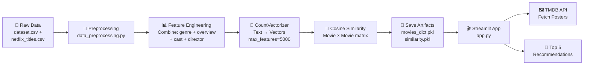

# Netflix Content-Based Movie Recommendation System

Build a content-based movie recommendation system using Python + ML that recommends the top 5 similar movies with poster art, deployed via a Streamlit web app.

## Datasets Available

| File                                                                                                    | Rows    | Columns                                                                                                               |
| ------------------------------------------------------------------------------------------------------- | ------- | --------------------------------------------------------------------------------------------------------------------- |
| [dataset.csv](file:///d:/PROJECTS/AIML/NETFLIX RECOMMANDATION SYSTEM/dataset/dataset.csv)               | ~10,005 | `id, title, genre, original_language, overview, popularity, release_date, vote_average, vote_count`                 |
| [netflix_titles.csv](file:///d:/PROJECTS/AIML/NETFLIX RECOMMANDATION SYSTEM/dataset/netflix_titles.csv) | ~8,809  | `show_id, type, title, director, cast, country, date_added, release_year, rating, duration, listed_in, description` |

## Tools Used in the Project

### Data Preprocessing and Machine Learning

- **Python** - Main programming language
- **Pandas** - Loading, cleaning, merging, and transforming datasets
- **NumPy** - Numerical array and matrix operations
- **Scikit-learn** - `CountVectorizer` for text vectorization and `cosine_similarity` for comparing movies
- **Pickle** - Saving and loading the trained movie data and similarity matrix

### Web Application and API

- **Streamlit** - Building and running the interactive recommendation web app
- **Requests** - Calling the TMDB API to retrieve movie poster images
- **TMDB API** - Providing movie poster artwork using movie IDs

### Development and Project Tools

- **pip** - Installing Python dependencies from `requirements.txt`
- **CSV** - Storing the source movie datasets
- **Mermaid** - Visualizing the project architecture in this documentation

## 🚀 How to Run

### Prerequisites

- Python 3.8 or higher
- pip (Python package manager)

### Step 1 — Install Dependencies

```bash
pip install -r requirements.txt
```

### Step 2 — Run Data Preprocessing

This step cleans the data, builds the similarity matrix, and saves model artifacts to `model/`. You only need to run this **once**.

```bash
python data_preprocessing.py
```

### Step 3 — Launch the App

To display posters, set a TMDB API key in the `TMDB_API_KEY` environment variable. Without it, the app displays a placeholder image. For PowerShell:

```powershell
$env:TMDB_API_KEY = "your_tmdb_api_key"
```

Do not commit API keys to the repository.

```bash
streamlit run app.py
```

The app will open in your browser at **http://localhost:8501**
----------------------------------------------------------

## Proposed Changes

### Data Preprocessing & Model Training

End-to-end preprocessing and model building script:

1. **Load & Clean Data**

   - Load `dataset.csv` (primary: has TMDB `id` for poster fetching)
   - Load `netflix_titles.csv` (secondary: has `cast`, `director`)
   - Merge on `title` to combine features
   - Handle missing values (fill NaN with empty strings)
   - Drop duplicates
2. **Feature Engineering**

   - Combine key features into a single `tags` column:
     ```
     tags = genre + overview + cast + director
     ```
   - Lowercase and clean text (remove special chars, extra spaces)
3. **Vectorization & Similarity**

   - Use `CountVectorizer(max_features=5000, stop_words='english')` to convert `tags` → numerical vectors
   - Compute `cosine_similarity` matrix across all movies
4. **Save Artifacts**

   - Save the processed DataFrame as `model/movies_dict.pkl` (pickle)
   - Save the similarity matrix as `model/similarity.pkl`

---

### Streamlit Web Application

#### [NEW] [app.py](file:///d:/PROJECTS/AIML/NETFLIX RECOMMANDATION SYSTEM/app.py)

The main Streamlit application:

- **Movie Selection**: Dropdown (`st.selectbox`) with all movie titles
- **Recommend Button**: On click, compute top 5 similar movies using the cosine similarity matrix
- **Poster Fetching**: Use TMDB API to fetch poster URLs via movie ID (with fallback)
- **Display**: Show 5 columns, each with poster image + movie title
- **Custom CSS**: Netflix-inspired dark theme with red accents

**Recommendation Logic:**

```python
def recommend(movie):
    movie_index = movies[movies['title'] == movie].index[0]
    distances = similarity[movie_index]
    movies_list = sorted(list(enumerate(distances)), reverse=True, key=lambda x: x[1])[1:6]
    return [(movies.iloc[i[0]].title, movies.iloc[i[0]].id) for i in movies_list]
```

---

### Configuration & Dependencies

#### [NEW] [requirements.txt](file:///d:/PROJECTS/AIML/NETFLIX RECOMMANDATION SYSTEM/requirements.txt)

```
streamlit
pandas
numpy
scikit-learn
requests
```

#### [NEW] [model/](file:///d:/PROJECTS/AIML/NETFLIX RECOMMANDATION SYSTEM/model/) (directory)

Output directory for serialized model artifacts (`movies_dict.pkl`, `similarity.pkl`).

---

## Architecture Flow



## Verification Plan

### Automated Tests

- Run `data_preprocessing.py` and verify `.pkl` files are generated in `model/`
- Launch `streamlit run app.py` and verify the app loads without errors

### Manual Verification

- Select a movie (e.g., "The Godfather") and confirm the 5 recommendations are thematically similar
- Verify poster images load correctly
- Test edge cases: movies with minimal metadata
